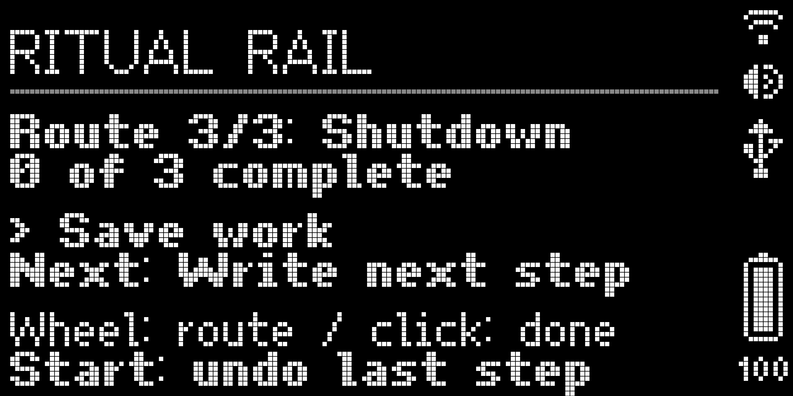

# Ritual Rail

Keep three daily routines on your desk with custom steps, undo and automatic progress recovery.

Leave the next small job in sight while your hands are busy. Each of the three routines has its own position, so you can check your shutdown list at lunch and still find the morning routine where you left it.

## Screen transitions

Follow the selected routine through a step change and an undo. The stops show how far you have progressed.


<details>

<summary>Watch the rear display</summary>



</details>

## Pick a routine at the desk

1. Turn the wheel through **Morning**, **Focus** and **Shutdown**. The name appears above the current step. The rear display also shows the next step if there is one.
2. For the default morning routine, start with **Water**. Click once when you have done it. The front advances to **Light** and fills the first progress square.
3. Keep turning the wheel if you need a different list. Changing views preserves each routine’s position.


## Undo a step you skipped

1. Press **Start** to move back one step on the active routine. In this example **Light** goes back to **Water**.
2. Complete the step, then click to advance again. The filled squares count the steps you have actually marked.
3. On completing the last step, leave the bar on **All done!** or turn to another routine. The date change starts a fresh round.


## Write a routine you can read at a glance

In app settings, enter up to seven short ASCII steps per route, divided by `|`. A focus list for recording audio might read `Close door | Plug in mic | Check level | Record`. Short verbs fit on the front display. Longer steps scroll.

Progress is stored with the date and the exact list. Reopening the app on the same day brings back the recorded count. Editing the list restarts that routine at its first step.

## Run in the emulator

Open BUSY Bar Emulator. From this repository, run:

```sh
~/.busy-emulator/bin/busy-emulator dev --once
```

Press **Back** to exit.

The GIFs are excerpts from the emulator recording. Each LED occupies a 16 × 16 cell with a black border. The end frames pause for reading.

[Full recording](media/controls.mp4) · [Rear display](screenshots/back-1.png) · [Firmware test](EMULATOR-QA.md) · [MIT license](LICENSE)

## Device settings

Open **Apps → Ritual Rail → Setup**. Save the fields and reopen the app to use the new values.

- **Morning steps (use |)** (`route0`). Default: `Water | Light | Stretch | Plan`.
- **Focus steps (use |)** (`route1`). Default: `Clear desk | Pick task | Silence phone`.
- **Shutdown steps (use |)** (`route2`). Default: `Save work | Write next step | Close desk`.
